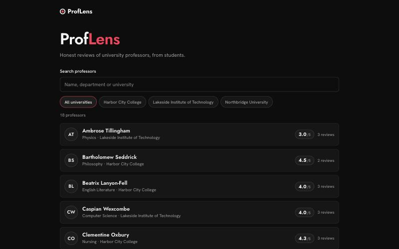

# ProfLens

Honest reviews of university professors, from students. Search professors by name, department or
university, read what students thought of their classes, and post your own review.

**Live demo:** [proflens-aomar.web.app](https://proflens-aomar.web.app)

A ground-up rebuild of a 2019 student project (Express + MongoDB) as a static React + Firestore app.

All professors, universities and reviews in this app are fictional, invented for the demo.



## Features

- **Search as you type** across professor names, departments and universities, with university
  filter chips. The search is mirrored into the address bar, so Back from a professor restores it.
- **Professor pages** with overall quality, level of difficulty, would-take-again percentage, a
  rating distribution, top tags, courses and every review, newest first.
- **Rate a professor** with a form that mirrors the original fields: course, a 1 to 5 star rating,
  difficulty, would take again, for credit, textbook used, attendance mandatory, grade received, up
  to three tags and a 20 to 350 character comment. Validation explains each problem inline and in a
  summary at the top of the form.
- **Your new review is highlighted** when you land back on the professor page, and the page notes
  that you have reviewed this professor (remembered on your device only).
- **Accessible and mobile first**: semantic HTML, labelled controls, native radios and checkboxes
  for keyboard use, visible focus, AA contrast, and motion only when the system allows it.

## Stack

- Vite, React 19 and TypeScript (strict)
- Cloud Firestore through the Firebase JS SDK v12 (modular)
- Firebase Hosting on the free Spark plan: no Cloud Functions, no Auth, no Storage
- No router or UI library: a small history-based router and hand-written CSS

## Technical notes

### Security rules are the validation layer

There is no server code, so `firestore.rules` is the only thing standing between a client and the
database. Professors can be read but never written by clients. A review can only be created, never
updated or deleted, and only when:

- it has exactly the expected keys, with the right types;
- `rating` and `difficulty` are integers from 1 to 5;
- `grade` is one of the allowed values and each tag comes from the fixed list, with at most three
  tags and no duplicates;
- the comment is 20 to 350 characters;
- `course` is one of that professor's courses (checked with a `get()` of the professor document);
- `createdAt` equals `request.time`, so nobody can backdate a review;
- the document id is a Firestore auto id.

The form runs the same checks first (`src/lib/validateReviewDraft.ts`) so students get a specific
message instead of a rejected write. The allowed values live in `src/lib/reviewOptions.ts` and are
repeated in the rules file; change both together.

There is no sign-in, so the rules cannot stop one person from posting many reviews. The "You've
reviewed this professor" note is a friendly hint stored in `localStorage`, not a limit. A
production version would add Firebase Auth (or App Check) and key reviews by user.

### Aggregation in the browser

The professor page loads that professor's reviews once and computes the averages, percentages,
distribution and top tags client-side (`src/lib/summarizeReviews.ts`). That keeps the app on the
free plan with no Cloud Functions, and is fast for the few dozen reviews a professor has here. A
professor with thousands of reviews would need paginated reviews and server-maintained aggregates
(a Cloud Function updating a stats document on every new review).

The home list needs a rating for every professor without downloading every review, so it uses
Firestore aggregation queries (`count()` and `average('rating')`), which the server computes and
bills as one read per 1,000 reviews covered.

### Search

The home page loads the professors collection once and filters it in the browser, ignoring case
and accents. That suits the seeded demo of eighteen professors. A production directory would use a
search index (such as Algolia, Typesense or Meilisearch) instead of downloading the collection.

## Run locally

Requires Node 22 or newer.

1. Create a Firebase project (the free Spark plan is enough), add a web app, and enable Cloud
   Firestore.
2. Copy `.env.example` to `.env.local` and fill in the web app's settings.
3. Install and start:

   ```sh
   npm install
   npm run dev
   ```

Without `.env.local` the app shows a "not configured" message instead of failing.

## Seed the database

The demo data lives in `seed/professors.json` (18 fictional professors across three fictional
universities) and `seed/reviews.json` (sample reviews keyed by professor id).
`scripts/seed.mjs` writes it through the Firestore REST API with no extra dependencies. It uses
fixed document ids, so running it again resets the seeded documents instead of duplicating them;
reviews posted from the app are left alone.

```sh
FIREBASE_PROJECT_ID=your-project-id \
FIRESTORE_TOKEN="$(gcloud auth print-access-token)" \
npm run seed
```

The token belongs to a project owner, so the writes bypass the security rules. That is how the
seeded reviews keep their historical dates, which clients could never write.

Until the database is seeded, the home page shows "No professors to show yet" and the browser
console reminds you to run the seed.

## Deploy (Firebase Hosting, free plan)

`firebase.json` deploys the `dist` folder to the hosting target `proflens`, rewrites app routes to
`index.html`, serves hashed assets with a one-year immutable cache, and keeps `index.html` and app
routes on `no-cache` so a new deploy is picked up straight away.

A Firebase project has one set of Firestore rules, shared by every app in it. If the project
already serves other apps, do not deploy `firestore.rules` (and never run a plain `firebase deploy`):
that would replace their rules with these. Merge the `professors` block from `firestore.rules` into
the project's existing rules instead, and deploy hosting only:

```sh
npm run build
firebase use --add                                   # pick your project
firebase hosting:sites:create your-site-id           # optional: a site of its own
firebase target:apply hosting proflens your-site-id
firebase deploy --only hosting:proflens
```

In a project dedicated to ProfLens, deploy the rules and indexes with the site:

```sh
firebase deploy --only hosting:proflens,firestore
```

## Project structure

```
src/
  components/   one component per file
  hooks/        data loading, submission, focus and routing hooks
  lib/          data access, validation, aggregation, formatting and routing helpers
  pages/        the four views: home, professor, rate, not found
  styles/       global.css with the design tokens
seed/           fictional demo data
scripts/        seed.mjs
```
